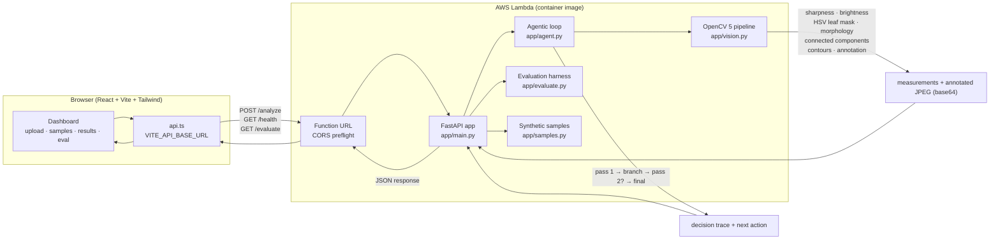

# Architecture — CropLens Agent

## Mermaid diagram



## Component breakdown

### Frontend (`src/`)

| Component | Responsibility |
|-----------|---------------|
| `App.tsx` | Orchestrates upload → analysis → results → evaluation. Manages state, progress, error handling. |
| `api.ts` | Single backend client. Resolves `VITE_API_BASE_URL` or falls back to the Vite `/api` dev proxy. |
| `types.ts` | TypeScript types mirroring the Pydantic schemas (single source of truth for the response shape). |
| `hooks.ts` | `useConnectionHealth` polls `/health` and reports the live OpenCV version + status. `useAbortable` cancels in-flight requests. |
| `components/UploadZone` | Accessible drag-and-drop + click upload. Validates file types. |
| `components/BeforeAfter` | Slider-based original vs. annotated comparison. |
| `components/DecisionTrace` | Renders the agentic trace as a timeline (pass → branch → final). |
| `components/EvaluationPanel` | Runs the synthetic suite and renders metrics + CSV export. |
| `components/Banner` | Reusable status banners and quality bars. |

### Backend (`backend/app/`)

| Module | Responsibility |
|--------|---------------|
| `main.py` | FastAPI app. Endpoints: `/health`, `/analyze`, `/samples`, `/samples/{id}`, `/samples/{id}/analyze`, `/evaluate`. CORS. Lambda handler via Mangum. |
| `vision.py` | **Real OpenCV pipeline.** Sharpness (Laplacian variance), brightness, HSV green-leaf mask, morphology, connected components, yellow/brown anomaly candidates restricted to the leaf mask, contours → measurable regions, annotated image + mask encoding. |
| `agent.py` | **Deterministic agentic state machine.** Pass 1 measures quality/coverage → branches (no-leaf / recapture / low-coverage / continue) → optional pass 2 with CLAHE normalization + relaxed thresholds on uncertain results → final action (accept / recapture / human-review / no-leaf). Emits a full trace. |
| `evaluate.py` | Synthetic leaf generator with known anomaly masks (4 severities × 4 degradations × N seeds). Computes IoU, precision, recall against ground truth. Writes CSV + JSON. |
| `samples.py` | Synthetic sample leaves for the UI's "Try a sample" mode (including blurry and dark quality-failure examples). |
| `schemas.py` | Pydantic models — the contract between Python and TypeScript. |

### Data flow (single analysis)

1. User drops a file → `UploadZone` → `api.analyzeUpload` POSTs multipart to `/analyze`.
2. FastAPI validates type/size. For video, OpenCV samples up to 4 frames; the middle frame is analyzed.
3. `run_agent()` calls `analyze_frame()` (pass 1).
4. The agent inspects pass-1 measurements:
   - No leaf → stop, `no_leaf_found`.
   - Poor focus/exposure → stop, `request_recapture`.
   - Uncertain anomaly area → pass 2 with CLAHE + relaxed thresholds → adopt whichever pass has better leaf coverage.
5. Final decision: anomaly area ≥ 5% → `request_human_review`; else `accept`.
6. Response includes: quality flags, measurements, regions, annotated image, leaf mask, anomaly mask, all passes, the full trace, next action, and limitations.
7. The frontend renders before/after comparison, masks, quality bars, metrics, the trace timeline, and the limitations.

### Why the loop is "agentic"

The second pass is not unconditional. It is triggered **only** when pass-1
anomaly area falls in an uncertainty band (0.5%–3%) and there are ≤ 2 regions.
The pass-2 result is adopted only if it improved leaf coverage. The branch
taken and the parameters changed are recorded in the trace — so the behavior is
inspectable and deterministic, not a fixed explanation.

### OpenCV 5 enforcement

`backend/app/vision.py` asserts at import time:

```python
assert cv2.__version__.startswith("5"), ...
```

The Dockerfile repeats this check at build time, so a wrong-OpenCV image cannot
be deployed.
